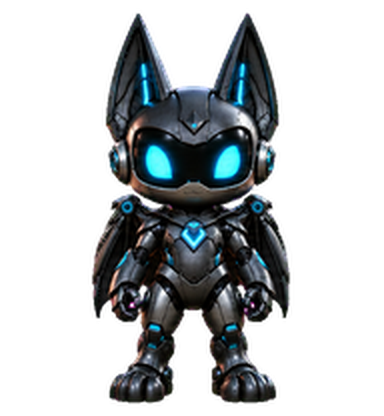

# Nyx

[Deutsche Version](README.md)

Nyx is a small black robot with cyan eyes and bat wings. He accompanies your work with nine animations and looks in 16 directions.

 

## Installation

Download the `Nyx` folder, copy it to `~/.codex/pets/nyx`, then select Nyx in Codex.

To import through Pet management, download [nyx-spritesheet.webp](nyx-spritesheet.webp). The sprite sheet is also available as a [PNG](nyx-spritesheet.png).
